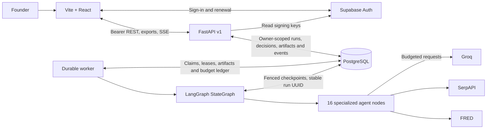
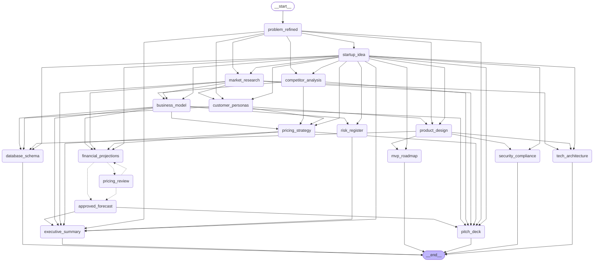

# CoFounder-Agent

Founders often need research, product planning, financial modeling, and technical design before they can compare startup ideas. CoFounder-Agent turns a problem statement into a reviewable startup plan. It organizes evidence, labels assumptions and partial results, and exports the committed work as Markdown, PDF, and PowerPoint.

The local app uses Vite, React, JavaScript, FastAPI, Pydantic, LangGraph, and PostgreSQL. Supabase Auth provides sign-in and the API verifies the project's asymmetric signing keys. Groq generates live output. Optional SerpAPI and FRED integrations supply research evidence. Deterministic fixture providers support repeatable checks and local demonstrations.

## Architecture



LangGraph controls dependency joins, bounded parallel execution, and the native pricing interrupt. The worker claims jobs and keeps leases alive. The store fences both application and checkpoint writes, so a recovered worker resumes the same run UUID and can reuse committed artifacts after a crash. Its immutable artifact revisions, review receipts, budgets, and SSE event log all live in PostgreSQL.

Every node loads committed required inputs, consumes successful optional inputs when available, and validates its output before publication. A failed prerequisite blocks its required consumers. Independent agents continue, and the results page and exports identify missing sections.

| Phase | Agents |
| --- | --- |
| Foundation | Problem Refiner, Idea Generator |
| Research | Market Research, Competitor Analysis, Customer Personas |
| Product | Product Designer, MVP Roadmap |
| Business | Business Model, Pricing Strategy, Financial Projections, Risk Analyst |
| Technical | Technical Architecture, Database Schema, Security and Compliance |
| Investor | Pitch Deck, Executive Summary |

### Current compiled dependency graph

The diagram comes from the reviewed StateGraph in `backend/run_worker/graph.py`. Dashed routing edges include the pricing interrupt and its resume routes. The [verification report](docs/final-project-verification.md) lists required inputs and optional edges for each node.

<!-- GRAPH_START -->

<!-- GRAPH_END -->

### Pricing review, evaluation, and provider limits

With `V1_REQUIRE_PRICING_REVIEW=true`, the graph pauses after draft financials. Approval resumes the thread. A pricing edit creates an immutable revision and a replacement checkpoint. Approval of the revised prices recomputes financials and downstream investor artifacts. Rejection leaves draft history visible, and the completed partial export identifies unavailable sections.

Deterministic evaluations report relevance, completeness, consistency, and evidence. Financial breakdowns are validated against approved pricing on revised forecasts. SerpAPI and FRED sources retain provenance, and market or macro research can be unavailable. Evaluation scores and generated projections require founder judgment.

The Groq adapter owns timeouts, retry backoff, compatible fallback, and usage accounting. It reserves capacity before dispatch and shares the run's token and estimated cost limits across concurrent agents. Optional Groq judging shares the same budget. See the [worker guide](backend/run_worker/README.md) for metering, models, and operational details.

## Run locally on Windows

Use Python 3.11, Node 22.21.1+ on the 22.x line or Node 24, and PostgreSQL. Install from the repository root.

```powershell
py -3.11 -m venv .venv
.\.venv\Scripts\python.exe -m pip install -r backend/requirements.txt
npm.cmd --prefix frontend-vite ci
Copy-Item backend/.env.example backend/.env
```

Use an existing local PostgreSQL instance or run `docker compose up -d postgres`. The compose service binds to loopback. Edit the ignored `backend/.env` with its direct psycopg `postgresql://` DSN. Run the repeatable migrations, then start the API and worker in separate PowerShell terminals from the repo root.

```powershell
.\.venv\Scripts\python.exe -m backend.run_worker.migrate
.\.venv\Scripts\python.exe -m uvicorn backend.main:app --host 127.0.0.1 --port 8000 --no-access-log
```

```powershell
.\.venv\Scripts\python.exe -m backend.run_worker.worker
```

### Configure sign-in

Use an isolated local Supabase stack or an authorized disposable project with ES256 or RS256 signing. Run `supabase init` in a separate test directory and use `supabase gen signing-key --algorithm ES256` to write a private key to its `supabase/signing_keys.json`. Set `signing_keys_path = "./signing_keys.json"` under `[auth]`, then start the stack with `supabase start`. Provision a confirmed email/password account in the isolated instance. Keep signing keys and administrative keys outside this repository. [Supabase CLI and asymmetric keys](https://supabase.com/docs/reference/cli/supabase-gen-keys)

Set `SUPABASE_URL` in `backend/.env` to the exact project origin in the issued token's `iss`, without `/auth/v1`. Loopback HTTP is supported only for local development. In `frontend-vite/.env.live.local`, set the matching origin and the browser-public key.

```dotenv
VITE_SUPABASE_URL=http://127.0.0.1:54321
VITE_SUPABASE_PUBLISHABLE_KEY=sb_publishable_your_public_key
```

Start the React app in another terminal and open the printed URL.

```powershell
npm.cmd --prefix frontend-vite run dev:live
```

### Choose a run mode

- **Local full-stack demo.** Set `V1_PROVIDER_MODE=fake` for the API and worker. React signs in, talks to FastAPI, and runs all 16 nodes with deterministic values. Reports label these values as a fake-provider demonstration.
- **Frontend-only preview.** Run `npm.cmd --prefix frontend-vite run dev:mock` to browse labelled fixtures without setting up PostgreSQL or sign-in. The production build uses the real API client.
- **Groq mode.** Set `V1_PROVIDER_MODE=live` and an authorized `GROQ_API_KEY`, pick test budget limits, and restart both backend processes. Add optional `SERPAPI_API_KEY` and `FRED_API_KEY` only for intended research use.

| Setting | Location and purpose |
| --- | --- |
| `DATABASE_URL` | Backend direct PostgreSQL connection for application rows and checkpoints |
| `ENVIRONMENT`, `V1_PROVIDER_MODE` | Backend environment and explicit fake/live execution selection |
| `SUPABASE_URL`, `VITE_SUPABASE_URL`, `VITE_SUPABASE_PUBLISHABLE_KEY` | Verified issuer and public browser sign-in configuration |
| `V1_JWT_SECRET`, `V1_JWT_ISSUER`, `V1_JWT_AUDIENCE` | Local API test issuer when Supabase is unconfigured. Browser sign-in uses Supabase |
| `GROQ_API_KEY`, `SERPAPI_API_KEY`, `FRED_API_KEY` | Server-side provider and optional research credentials |
| `MAX_CONCURRENT_RUNS`, `V1_STEP_CONCURRENCY` | Shared worker admission and parallel agents per run |
| `V1_RUN_TOKEN_LIMIT`, `V1_RUN_COST_LIMIT_NANOUSD`, `V1_PROVIDER_TIMEOUT_SECONDS` | Per-run budgets and provider deadline |
| `V1_REQUIRE_PRICING_REVIEW`, `V1_REQUIRE_FOUNDER_REVIEW`, `V1_LLM_EVALUATION` | Pricing interrupt, final summary approval, and optional metered judging |
| `API_PROXY_TARGET`, `CORS_ORIGINS` | Vite dev proxy and explicit backend origins |
| `DEV_HTTPS_CERT`, `DEV_HTTPS_KEY` | Optional Vite dev TLS files for Windows Chromium PDF downloads |

## API and repository layout

FastAPI exposes `/health` and `/ready`. Open `/api/v1/docs` for REST. The v1 run collection accepts idempotent submissions and returns owner-specific history. Run endpoints provide snapshots, artifacts, SSE replay after an event ID, review decisions, and authenticated Markdown, PDF, and PPTX exports. [REST and SSE contracts](shared/contracts/README.md)

- `backend/agents/` holds all 16 prompt builders and agent-specific research integrations.
- `backend/run_worker/` contains the graph, durable store, reviewed prompt versions, evaluation, and worker entry point.
- `backend/export/` renders committed artifact data for download.
- `frontend-vite/` is the React workspace, history, results, review UI, and browser checks.
- `shared/contracts/` contains the published API and event schemas, examples, and fixtures.
- `docs/` contains the final verification record and historical release decisions.

## Checks and measured results

```powershell
$env:TEST_DATABASE_URL = 'postgresql://<test-user>:<password>@localhost:5432/<test-database>'
.\.venv\Scripts\python.exe -m pip check
.\.venv\Scripts\python.exe -m unittest discover -s backend/tests -v
.\.venv\Scripts\python.exe -m backend.contracts.tool --check --check-runtime
npm.cmd --prefix frontend-vite run lint
npm.cmd --prefix frontend-vite test
npm.cmd --prefix frontend-vite run build:live
$env:PLAYWRIGHT_CHROMIUM_CHANNEL = 'msedge'
npm.cmd --prefix frontend-vite run test:browser
```

See the [final verification report](docs/final-project-verification.md) for measured durations, the exact results, and the limits of the provider and browser checks. Grounding depends on available sources and correct interpretation. Forecasts are scenarios and may need founder edits. File downloads can require [local HTTPS in Windows Chromium](frontend-vite/README.md#verify-exports-over-local-https).

Project contributors are [Likhitha](https://github.com/DnvLikhitha) and [Surya](https://github.com/suryatejabatchu08).
