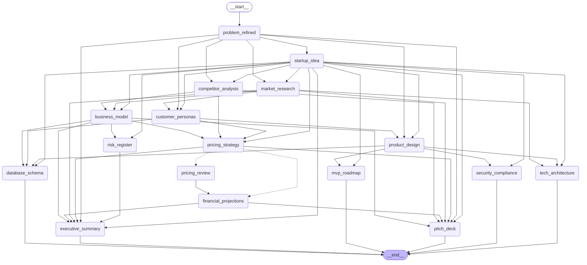

# LangGraph migration for Prompt 12.5

This document records an earlier candidate. See the [final local verification](../final-project-verification.md) for the maintained application and current results.

## Architecture and audit

This migration is based on `05b00d1`, which merged the worker hardening in PR #11. The mounted v1 API already supported Supabase Auth and owner isolation, idempotent submissions, PostgreSQL artifacts and public events, authenticated SSE replay, partial exports, an optional final executive-summary approval, and a fenced Groq attempt ledger. Evaluation records were `not_evaluated`. Browser production sign-in and automatic token refresh were still outside the backend. The old Next.js routers referenced `StartupOrchestrator` but were unmounted by the FastAPI entry point.

| Concern | Before | With LangGraph |
| --- | --- | --- |
| New submission | Custom live scheduler or four-step fake demo | `startup-langgraph-v1` in both modes |
| Scheduling | Worker scans ready steps using its own executor | StateGraph executes each specialized node, joins predecessors, and routes around or through the pricing checkpoint |
| Runtime and queue | Separate process, PostgreSQL claims and leases | Same worker and queue, with graph-aware admission and heartbeat |
| Workflow position | Inferred from application step statuses | Native PostgreSQL checkpoints with the same lease fence |
| Provider calls | Spawned agent subprocess and hardened Groq adapter | Same live adapter and subprocess deadline, plus a deterministic development fixture provider |
| Browser | Owner-scoped v1 REST, SSE, and exports | Same paths, payloads, event types, and artifact identifiers |

LangGraph makes dependency progression and resumable state explicit. The application store continues to own all browser-visible state. See the official [overview](https://docs.langchain.com/oss/python/langgraph/overview), [Graph API](https://docs.langchain.com/oss/python/langgraph/graph-api), [persistence](https://docs.langchain.com/oss/python/langgraph/persistence), and [interrupts](https://docs.langchain.com/oss/python/langgraph/interrupts).

## Complete dependency graph

Every agent receives the founder input and its applicable context fields. Node names also serve as step IDs and immutable artifact identifiers. Each response is validated against the existing per-agent schema in `backend/run_worker/live_outputs.py`. Customer personas publish an array and the pitch deck publishes an object with slides. Both graphs and reports use those original artifact shapes. Optional producers participate in joins, so a consumer sees a committed artifact or a known unavailable outcome.

| Node | Agent | Required committed artifacts | Optional artifacts |
| --- | --- | --- | --- |
| `problem_refined` | Problem Refiner | None | None |
| `startup_idea` | Idea Generator | `problem_refined` | None |
| `market_research` | Market Research | `problem_refined`, `startup_idea` | None |
| `competitor_analysis` | Competitor Analysis | `problem_refined`, `startup_idea` | None |
| `customer_personas` | Customer Personas | `problem_refined`, `startup_idea`, `market_research` | None |
| `product_design` | Product Designer | `problem_refined`, `startup_idea`, `customer_personas` | None |
| `mvp_roadmap` | MVP Roadmap | `startup_idea`, `product_design` | None |
| `business_model` | Business Model | `startup_idea`, `market_research`, `competitor_analysis` | None |
| `pricing_strategy` | Pricing Strategy | `startup_idea`, `business_model` | `competitor_analysis`, `customer_personas` |
| `financial_projections` | Financial Projections | `startup_idea`, `market_research`, `business_model`, `pricing_strategy` | None |
| `risk_register` | Risk Analyst | `startup_idea`, `business_model` | None |
| `tech_architecture` | Technical Architecture | `startup_idea`, `product_design` | `market_research` |
| `database_schema` | Database Schema | `startup_idea`, `product_design`, `business_model`, `customer_personas` | None |
| `security_compliance` | Security and Compliance | `startup_idea`, `product_design` | None |
| `pitch_deck` | Pitch Deck | `problem_refined`, `startup_idea`, `market_research`, `business_model`, `pricing_strategy`, `financial_projections` | `competitor_analysis` |
| `executive_summary` | Executive Summary | `problem_refined`, `startup_idea`, `market_research`, `business_model`, `pricing_strategy`, `financial_projections` | `risk_register` |

The diagram shows compiled scheduling edges. The table also lists artifact reads whose ordering is already implied by a path. Financials can run directly after pricing or after the pricing review node. All its other prerequisites are ancestors of pricing, and the store still checks each committed required input before dispatch. LangGraph applies its normal superstep barriers and the graph adds no layer-wide joins. Failed nodes record an outcome and release their scheduling edges. Each blocked consumer then records `dependency_blocked` without calling the provider. A failed optional producer supplies no artifact. Missing required financials block both investor documents and existing partial exports retain the available sections.



## State and recovery

| Checkpoint field | Source and purpose |
| --- | --- |
| `run_id`, `input` | Server-generated UUID and normalized founder input with problem, domain, and geography |
| `workflow_version`, `provider_mode`, `model_profile`, `prompt_version` | Pinned application run configuration. Fake mode has no Groq model profile |
| `outcomes` | Per-node terminal status, sanitized error, required and optional dependency statuses, immutable artifact reference and IDs pointing to research evidence or assumptions |
| `review_pricing`, `review` | Internal pricing gate flag and approved artifact metadata used by the deterministic demonstration |

Graph state uses a TypedDict and serializable values. Parallel nodes write independent outcome keys. The reducer sorts keys, accepts equal repeats, and rejects conflicting values. Nodes hydrate separate agent contexts from committed artifact bodies. Credentials, provider clients, store connections, and artifact bodies stay outside the graph state.

Application tables remain authoritative for run ownership, status, artifacts, budget, and SSE. The LangGraph checkpoint tables own execution position and pending node writes. The worker invokes the graph with synchronous checkpoint durability. The server-generated run UUID is the stable thread ID. The saver verifies that ID, obtains a lock on the run row, and checks the claim token and expiry both before and after each checkpoint transaction. The existing application store separately fences artifact, event, and accounting writes. PostgreSQL serializes queue admission across worker processes using `MAX_CONCURRENT_RUNS`. Each graph uses `V1_STEP_CONCURRENCY`, so workers sharing a database should use the same limits.

| Failure window | Recovery |
| --- | --- |
| Provider returns before the artifact commits | The next valid claim retries the pending node through the existing ledger. An unsettled reservation retains its full charge. A settled attempt retains its usage and counts toward the attempt cap. |
| Artifact and event commit before the graph write | The repeated graph node reads the committed outcome and returns its reference without issuing a second provider request or event. |
| Last checkpoint commits before terminal run status | The next claim loads the completed graph and commits terminal application state. |
| Lease is lost or several nodes are in progress during a crash | The worker cancels active provider children when it detects lease loss. Replacement claims resume the same thread. Stale application writes and checkpoint writes are rejected. |
| Pricing interrupt commits before the worker parks | The replacement reads the stored interrupt and parks the run. A matching owner-authorized resume starts the native continuation. |

PostgresSaver uses one direct psycopg connection for a claimed graph. Its additive schema migration runs under a session advisory lock, including the upstream concurrent index DDL. The checkpoint tables use RLS and revoke direct access from `PUBLIC`, `anon`, and `authenticated`. Access through the application still requires an authenticated owner. Graph tracing is disabled.

## Setup and testing

Python 3.11 uses pinned `langgraph==1.2.24`, `langgraph-checkpoint==4.3.2`, `langgraph-checkpoint-postgres==3.2.1`, `psycopg[binary]==3.2.3`, and `psycopg-pool==3.3.3`. The worker uses local LangGraph and PostgreSQL. It needs no hosted orchestration account or tracing credentials. See the [worker runbook](../../backend/run_worker/README.md) for database, JWT, and provider settings and how to submit a run.

```powershell
python -m pip install -r backend/requirements.txt
python -m backend.run_worker.migrate
$env:ENVIRONMENT = 'development'
$env:V1_PROVIDER_MODE = 'fake'
python -m uvicorn backend.main:app --no-access-log
```

Set the same database, environment, and mode in the worker shell.

```powershell
python -m backend.run_worker.worker
# Or process one eligible claim
python -m backend.run_worker.worker --once
```

For Groq execution, set `V1_PROVIDER_MODE=live` in both processes, set `GROQ_API_KEY` through the approved secret mechanism, and use the same worker command. SerpAPI and FRED credentials are optional. Production requires live mode and the configured Supabase issuer. Real-provider tests require approved credentials and an explicit cost budget.

```powershell
$env:TEST_DATABASE_URL = 'postgresql://<test-user>:<password>@localhost:5432/<test-database>'
python -m unittest discover -s backend/tests -v
python -m backend.contracts.tool --check --check-runtime
python -m pip check
Push-Location frontend-vite
npm.cmd ci
npm.cmd test
npm.cmd run lint
npm.cmd run build:live
Pop-Location
```

### Verification results

| Check | Result |
| --- | --- |
| `python -m unittest discover -s backend/tests -v` | 64 passed on disposable PostgreSQL 18.1 with UTC test sessions |
| `python -m backend.contracts.tool --check --check-runtime` | Passed generated OpenAPI, SSE replay fixtures, and mounted REST schema comparison |
| `python -m pip check` | Passed |
| `npm.cmd test`, `npm.cmd run lint`, `npm.cmd run build:live` | 22 Vite tests passed, lint passed, live production build passed |

Fake mode completed the 16-node graph through the API and a separate worker process. The native pricing interrupt released the claim, resumed in another process with the same thread, and completed all 16 artifacts. The live path ran all 16 specialized agents through the real adapter with simulated Groq, SerpAPI, and FRED responses. It produced 16 artifacts and 16 recorded provider attempts and verified Markdown, PDF, and PowerPoint content. The provider-failure tests also verified fallback, bounded retry exhaustion, and budget exhaustion. Approved credentials and a live spend budget were unavailable, so live provider quality, cost, and latency remain unverified. Hosted CI has yet to run on this branch.

## Rollout, rollback, and extension

Apply the migration with the trusted PostgreSQL role before starting the new API and worker. Use the graph-aware worker for new readiness heartbeats. Existing `live-startup-v1` and `fake-business-v1` or `fake-business-v2` jobs drain through their pinned scheduler, from their existing application rows. New v1 submissions always pin `startup-langgraph-v1`. Four-step histories and pre-migration exports remain readable by the existing owners.

For rollback, pause submissions and drain or retain a compatible worker for any queued, running, or parked LangGraph jobs. Roll back the API and worker as approved and keep both sets of tables. The older API can still read application records and artifacts. The older worker cannot advance the LangGraph manifest. Keep the matching graph binary and its checkpoint tables available for unfinished runs.

For a new agent, register its node ID, explicit required and optional dependencies, input hydration, prompt bundle, and output schema in a new workflow version. Retain compatible specifications for earlier jobs. Add valid demo data, dependency tests, and a diagram from the compiled graph. Check the browser's generic artifact viewer and any specialized renderer.

The optional executive-summary review from the prior release still uses the existing REST flow. The pricing gate is an internal migration test path. Prompt 14 should persist an owner-scoped review request that binds the run, pricing artifact revision, and native interrupt ID. The same database transaction should publish the review event and park the claim. On an authenticated and idempotent decision, persist the authorized resume payload and wake the matching run. Use `Command(resume={interrupt_id: decision})` with the existing thread ID and revalidate downstream artifact dependencies. Keep interrupt nodes side-effect-free on re-entry. Implement rejection, artifact revision, and evaluation policy in Prompt 14.

Useful limits to account for include normal graph supersteps, the current single pricing interrupt, and the provider's ability to complete a request that was already sent after the worker crashes. The ledger bounds and records those attempts. Historical Supabase staging, browser sign-in, and actual Groq quality and billing require separate live verification.

## Changed files and frontend review

| Files | Purpose |
| --- | --- |
| `backend/run_worker/graph.py`, `checkpoints.py` | Typed graph state, agent node scheduler, pricing interrupt, lease renewal, and the transactional PostgreSQL saver |
| `backend/run_worker/schema.sql`, `store.py` | Pinned graph provider mode, private interrupt and resume IDs, shared admission, checkpoint migrations, and readiness |
| `backend/run_worker/worker.py`, `workflow.py`, `provider_call.py`, `api.py`, `backend/config.py` | Manifest routing, old-run drainage, lease cancellation, submission and export integration, and queue limits |
| `backend/requirements.txt` | Pinned self-hosted LangGraph and PostgreSQL packages |
| `backend/run_worker/demo_outputs.json`, `backend/tests/test_live_agents.py`, `backend/tests/test_run_worker.py` | Move the synthetic fixture into the worker and exercise graph structure, providers, API behavior, and recovery |
| `README.md`, `backend/run_worker/README.md` | Updated setup and architecture |

The custom scheduler is now a compatibility path for pre-migration manifests. The legacy HTTP router and orchestrator sources remain unmounted. Surya should review successful and partial 16-step history, replay, artifact rendering, exports, and existing final-review behavior on the live Vite build. The migration supplies no public pricing review endpoint. Pricing review UX belongs to Prompt 14.

## PR draft

**Migrate the 16-agent durable worker to LangGraph**

Use one StateGraph for new fake and live runs, with PostgreSQL checkpoints fenced by the same lease as application writes. Preserve the original provider adapter, artifact schemas, event history, and owner-scoped browser contracts. Drain stored pre-migration workflows with their pinned scheduler and prove native pricing interrupt and resume across worker processes. Include the workflow diagram, recovery tests, and migration and rollback instructions.
